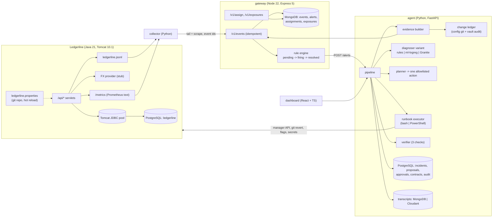

# Architecture

## Components and data flow



## One incident

```mermaid
sequenceDiagram
  autonumber
  participant L as Ledgerline
  participant C as collector
  participant G as gateway
  participant A as agent
  participant H as human
  L->>C: errors in logs, pool exhausted in metrics
  C->>G: POST /v1/events (event ids; retries are harmless)
  G->>G: rule pending for 6 s, then firing
  G->>A: POST /alerts (page)
  A->>A: settle 4 s, build evidence (60 s window + change ledger)
  A->>A: diagnose -> cause; plan -> one action + params
  A->>L: runbook --dry-run (same runbook, same privileges)
  A->>H: proposal + blast radius + fingerprint
  H->>A: approve, typing the fingerprint
  A->>A: consume approval once (atomic UPDATE), re-check params hash
  A->>L: runbook (real)
  loop up to N attempts
    A->>G: every paging alert resolved after the fix?
    A->>L: two scrapes: infra errors quiet? post-condition?
  end
  A->>A: resolved (or escalated) + postmortem draft
```

## Why these stores

* **PostgreSQL** for the agent's records: approvals and contracts need atomic conditional
  updates and constraints (`uses <= max_uses`, one consumed approval per proposal).
* **MongoDB** for raw events: append-heavy, schemaless, unique index on `event_id` gives
  idempotent ingest under concurrent writers.
* **Transcripts** (prompt and response per diagnosis) in MongoDB or IBM Cloudant:
  documents, never updated, read per incident.
* Ledgerline has its own PostgreSQL database: the watched service owns its data.

## Ports (local)

| :8080 | Tomcat (Ledgerline at /ledgerline, manager at /manager/text) |
|---|---|
| :7070 | gateway |
| :7080 | agent API and dashboard |
| :5432 | PostgreSQL |
